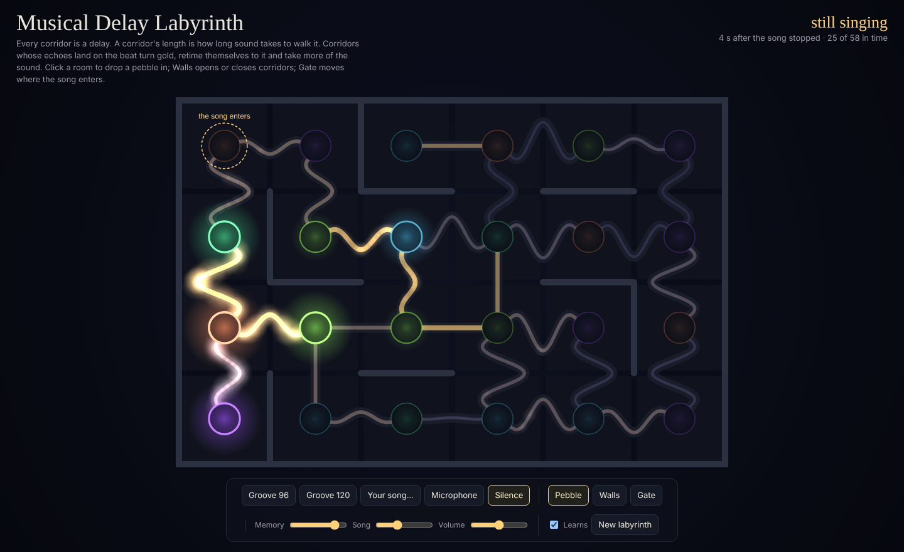

# Musical Delay Labyrinth

**A labyrinth of echoes that learns your song's time, and keeps playing it after the song stops.**

Open `index.html` (GitHub Pages, or straight from disk), press *Start sound*, and play it a groove, your own song, or the microphone.

*Four seconds after the groove stopped. Nothing is being fed in; the light is sound still walking the corridors.*

## What it is

- **Every corridor is a delay.** Sound takes D seconds to walk it, one delay line each way. On screen, a corridor's length *is* its delay: long meanders are long echoes.
- **The light is the sound.** Each glowing pulse is the energy actually sitting at that point in that delay line, both directions. Nothing is drawn that isn't in the audio buffers.
- **Rooms** sum what arrives, colour it with their own note (a minor-pentatonic resonance), and send it on. You hear every room, panned left to right by where it sits in the maze.
- **The song enters at the gate.** Its echoes spread through the maze and come back to your ears at many delays at once.

## What it learns: time, not loudness

Each corridor compares *when* its echoes arrive with *when* the song's own onsets (hits, notes) happen.

- **If the echo lands a little before a song onset, the corridor gets longer; if a little after, shorter.** The error is signed (early vs late), so corridors can lock onto the groove. (In the ResonatingMatter plate, the sand only felt loudness, which can't tell early from late; that is why it could only run away from the song.)
- **Corridors whose echoes land on the beat turn gold** and take a larger share of their room's sound. Off-beat corridors fade to violet.
- While corridors retime, their content shifts pitch slightly, like tape speeding up or slowing down. That is real, not an effect.

Then the song stops, and **the labyrinth keeps playing** fragments of it: the corridors that learned the beat keep handing echoes on, in time, slowly fading and smearing, like a tape loop wearing out. *Memory* sets how long.

**What you can do:** drop a pebble into any room (a click) and hear the labyrinth answer in its learned time; open or close walls to re-route it mid-song; move the gate; switch learning off; start a new labyrinth.

## Stable by construction

Rooms average their inputs (never amplify), their colouring filter peaks at unity gain, a soft limiter never adds gain, and each room hands at most a fraction *rho* ("Memory", 0.80–0.99) of its energy to its corridors. So the labyrinth always fades eventually. The test feeds loud noise at memory 0.99: peak 0.26; in the 30 s of silence after it, the output averages 3.4e-3 RMS and is down to 3.0e-8 in the last 5 s.

## Measured (`node tests/test.js`, results in `results/tests.json`)

Three labyrinths (seeds 7, 11, 23) × two grooves (96 and 120 BPM), 60 s each; the control is the identical labyrinth with learning off.

| Seed | BPM | Corridors within 15 ms of the half-beat grid, before → after | Beat in the 10 s after the song (on-beat / off-beat autocorrelation) | Same, learning off |
|---|---|---|---|---|
| 7 | 96 | 4 → 50 of 58 | 0.343 / 0.015 | 0.154 / 0.145 |
| 7 | 120 | 8 → 33 | 0.304 / 0.047 | 0.252 / 0.147 |
| 11 | 96 | 2 → 48 | 0.125 / 0.003 | 0.177 / 0.125 |
| 11 | 120 | 8 → 48 | 0.086 / 0.010 | 0.108 / 0.031 |
| 23 | 96 | 6 → 32 | 0.324 / 0.022 | 0.156 / 0.072 |
| 23 | 120 | 4 → 24 | 0.338 / 0.027 | 0.237 / 0.172 |

- **Retiming works in every run.** Corridors move onto the groove's half-beat grid.
- **After the song stops, a learned labyrinth keeps the beat in every run.** Its tail repeats strongly at ½, 1 and 2 beats and hardly at off-beat lags.
- **Better than not learning in 5 of 6 runs.** It fails on seed 11 at 120 BPM: the margin is 0.076 against the control's 0.077, a tie. That check is left failing in the test suite on purpose. Note too that an unlearned labyrinth already carries *some* beat, because the echoes are of a song that has one.
- Same seed + same song gives identical delays and weights.

## Honest ledger

- **Synthetic grooves only** were measured (kick, snare, hats, bass, chord stabs). Real songs run in the page but were not measured.
- Onsets are detected from loudness rises in 2.7 ms blocks; very smooth music (pads, drones) gives the learning little to lock on to.
- It locks to the half-beat grid because the test grooves have eighth-note hats; other music will pull it toward whatever its own inter-onset intervals are.
- The labyrinth plays back *fragments of the song itself*, rearranged in time. It does not compose new material.
- Not measured on your RTX 3060 machine. It runs on the CPU audio thread: about 9× real time in Node here, and real time in headless Chrome.
- The maze is seeded (randomized depth-first search plus a few loops); room notes are random picks from a minor pentatonic.

Built by Claude (Opus 5.5) for anttiluode, November 2026, after ResonatingMatter. Its one inheritance from that repo is the lesson that learning which feels only loudness can only flee; learning that feels timing can lock.
